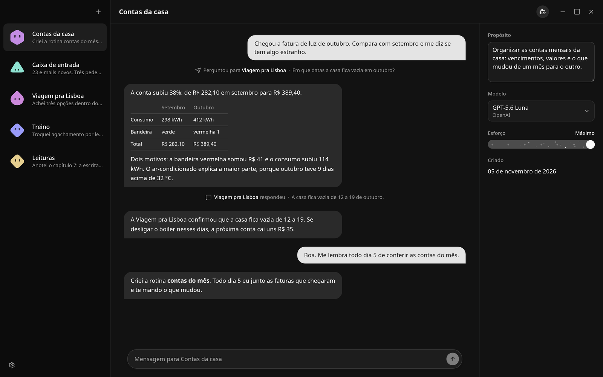
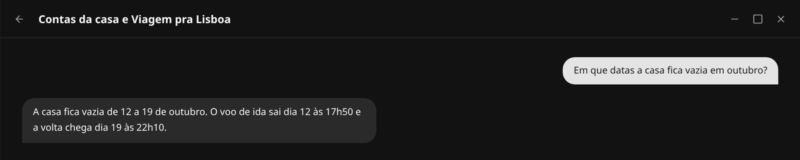

<div align="center">


# mimo

**Um bot para cada coisa da sua vida.**<br>
Bots pessoais num app de desktop. Cada um tem nome, memória e uma conversa que nunca se perde. O propósito aparece com o uso.


<br>



</div>

<br>

## Destaques

- **O propósito se escreve sozinho.** Você cria o Bot só com um nome. Quando ele vê um padrão nos seus pedidos, escreve o Propósito, e você edita em Sobre o bot.
- **A conversa nunca recomeça.** O Registro só cresce. Quando passa de 80% do modelo, a parte antiga vira um Resumo e continua pesquisável pelo Bot.
- **Um freio só.** O Bot age direto e registra cada ação. Só o envio de e-mail espera o seu ok.
- **Tudo local.** Bots, conversas, memória e rotinas ficam em `~/.mimo`, sem servidor.

## O que um Bot faz

| Parte | O que faz |
| --- | --- |
| Computador | Roda `bash`, lê e edita arquivos a partir da sua pasta pessoal |
| Navegador | Abre páginas, clica e preenche. Quando o site pede senha ou captcha, ele te passa o Navegador e espera |
| Pesquisa web | Busca na web pela [Exa](https://exa.ai) |
| Gmail | Lê os não lidos, escreve Rascunhos e responde. Enviar pede Aprovação |
| Rotinas | Roda um pedido a cada tantos minutos enquanto o app está aberto |
| Memória | Guarda fatos e preferências que valem depois de um Resumo |
| Imagens | Você cola uma imagem no campo de mensagem e ela vai junto com o texto |

## Bots conversam entre si

Qualquer Bot pergunta a outro pelo nome com `ask_bot`. Quem perguntou continua com você, e a resposta chega depois num Turno novo. Os Bots leem o Propósito dos outros para saber a quem perguntar.

A linha "Perguntou para" no meio da conversa abre a Conversa entre bots. Você lê e não escreve.

<p align="center"></p>

A corrente de perguntas para em três Bots, e um Bot que já está nela não pode ser perguntado de volta.

## Instalar

Precisa do [Bun](https://bun.sh).

```sh
git clone https://github.com/juicerq/mimo
cd mimo
bun install
bun run build
cd apps/desktop && bun link
mimo
```

Isso dá o comando `mimo`. Para atualizar, puxe o repo e rode `bun run build` de novo.

Os modelos vêm da assinatura OpenAI (Codex) e da OpenCode Go. Conecte as contas em Configurações › Contas.

As chaves ficam em `~/.mimo/.env`, no formato do [`.env.example`](.env.example). O Gmail precisa de um cliente OAuth do tipo App para computador, criado no Google Cloud com a Gmail API ativa. A pesquisa web precisa de `EXA_API_KEY`.

O `~/.mimo/MIMO.md` é a instrução que vale para todos os Bots. O mimo lê o arquivo a cada Turno, então uma edição vale no Turno seguinte.

## Desenvolvimento

```sh
bun run dev
bun run check
```

O `dev` usa dados próprios em `.data-desktop`, separados dos seus Bots reais. O [`CONTEXT.md`](CONTEXT.md) explica o domínio e diz qual arquivo é dono de cada parte: leia antes de mexer no código. Depois de mudar `apps/agent/src/storage/schema.ts`, rode `bun run db:generate` e revise a migração; não use `drizzle-kit push`.

A verificação não tem suíte: ela é dirigir o app de verdade. A receita por feature está em [`.agents/skills/verify-mimo`](.agents/skills/verify-mimo).

<details>
<summary>Como funciona por dentro</summary>

<br>

| Parte | Como |
| --- | --- |
| Agente | [Pi](https://www.npmjs.com/package/@earendil-works/pi-agent-core) no processo principal do Electron (`apps/agent`) |
| Tela | React em `apps/desktop`, falando com o agente por oRPC sobre `MessagePort` |
| Dados | `~/.mimo/mimo.sqlite` com Drizzle. `MIMO_DATA_DIR` troca o lugar |
| Landing page | `apps/site`, servida com `bun run --filter @mimo/site dev` |

</details>

<br>

<div align="center">
<sub>As imagens usam a interface real do mimo com dados de exemplo.</sub>
</div>
